<!--
   ██╗   ██╗ █████╗ ███████╗██╗  ██╗
   ╚██╗ ██╔╝██╔══██╗██╔════╝██║  ██║   👀 You opened the source. Respect.
    ╚████╔╝ ███████║███████╗███████║   Psst — there's an easter egg at the bottom.
     ╚██╔╝  ██╔══██║╚════██║██╔══██║   Every card here is a self-hosted SVG, redrawn
      ██║   ██║  ██║███████║██║  ██║   every 6 hours by scripts/update_readme.py.
      ╚═╝   ╚═╝  ╚═╝╚══════╝╚═╝  ╚═╝   Say hi: linkedin.com/in/yash-patil-6655b5215
-->

<p align="center">
  <a href="https://patilyash.tech">
    
  </a>
</p>

<p align="center">
  <a href="https://patilyash.tech"></a>
  <a href="https://www.linkedin.com/in/yash-patil-6655b5215/"></a>
  <a href="https://leetcode.com/u/yashpatil2121/"></a>
  <a href="#connect"></a>
</p>

<p align="center">
  
  <a href="https://github.com/yashpatil02121?tab=followers"></a>
  <a href="https://github.com/yashpatil02121?tab=repositories"></a>
</p>

<p align="center"></p>

<!-- ─────────────── CONTENTS ─────────────── -->
<p align="center">
  <a href="#about">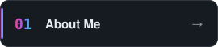</a>
  <a href="#building">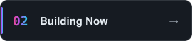</a>
  <a href="#activity">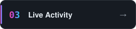</a>
  <a href="#stack">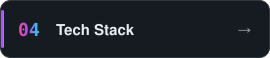</a>
  <a href="#journey">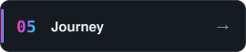</a>
  <a href="#stats">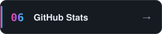</a>
  <a href="#setup">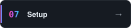</a>
  <a href="#connect">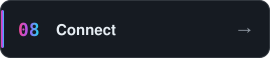</a>
</p>

<!-- ─────────────── 01 · ABOUT ─────────────── -->
<a id="about"></a>
<p align="center"></p>

<p align="center">
  
</p>

> I like the part of software that sits between people and machines — APIs that feel obvious, UIs that stay out of the way,
> and tools that remove a step from a developer's day. Lately that means **LLM-powered developer tooling**: Claude Code plugins,
> evaluation harnesses and automation that turns "ugh, manual" into one command.

<details>
<summary align="center"><b>Open <code>yash.ts</code></b> — the same thing, in TypeScript</summary>
<br/>
<p align="center">
  
</p>
</details>

<!-- ─────────────── 02 · BUILDING ─────────────── -->
<a id="building"></a>
<p align="center"></p>

<!-- Rebuilt every 6h: repos with the most commits in the last 30 days -->
<p align="center">
  
</p>

<h3 align="center">Featured</h3>

<!-- Cards rebuilt every 6h from scripts/featured.json + live repo data -->
<p align="center">
  <a href="https://github.com/yashpatil02121/feature-planner">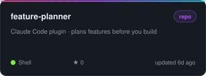</a>
  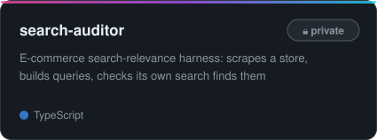
</p>
<p align="center">
  <a href="https://draftly-nwc5.onrender.com">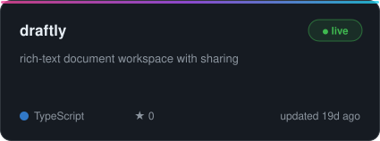</a>
  <a href="https://platepartners.vercel.app/">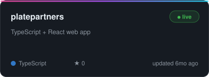</a>
</p>
<p align="center">
  <a href="https://prathamesh-caters.vercel.app">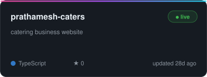</a>
  <a href="https://github.com/yashpatil02121/artifact-validator">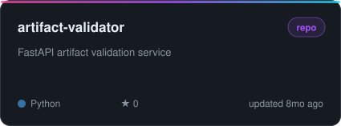</a>
</p>

<details>
<summary align="center"><b>📂 More things I've built</b></summary>
<br/>

| Project | What | Stack | Links |
|---|---|---|---|
| 🛠️ **makerz_network_frontend** | Makers network platform | TypeScript · React | [Code](https://github.com/yashpatil02121/makerz_network_frontend) |
| 🔎 **domsearch** | Search frontend + backend | TypeScript · Python | [Frontend](https://github.com/yashpatil02121/domsearch-frontend) · [Backend](https://github.com/yashpatil02121/domsearch-backend) |
| 🎙️ **voismi-frontend** | Web app | Next.js | [Code](https://github.com/yashpatil02121/voismi-frontend) |
| 🔄 **xmlToJson** | XML → JSON converter | JavaScript · Node.js | [Live](https://xml-to-json-frontend.vercel.app) · [Code](https://github.com/yashpatil02121/xmlToJson-frontend) |
| 🏷️ **Tags2Braces** | Dev tool | Java | [Code](https://github.com/yashpatil02121/Tags2Braces) |
| ⚡ **portfolio-fastapi** | Portfolio backend | Python · FastAPI | [Code](https://github.com/yashpatil02121/portfolio-fastapi) |
| 🦙 **Blog Generator (Llama 2)** | LLM blog writer | Python · Llama-2-7B | [Code](https://github.com/yashpatil02121/Blog-Generation-App-using-Llama-2-7B-Chat-GGML) |
| 🛡️ **Android Botnet Detection** | ML security | Python · ML | [Code](https://github.com/yashpatil02121/Android-Botnet-Detection-Using-Machine-Learning) |
| 🚌 **Educational Bus Routing** | B.E. major project | Python · Web | [Code](https://github.com/yashpatil02121/Enhanced-Routing-Efficiency-for-Educational-Bus-Networks) |
| 💧 **Digital Watermarking** | Image processing | Python | [Code](https://github.com/yashpatil02121/Digital-Water-Marking) |
| 🚗 **Car Trade Price Prediction** | ML mini project | Jupyter · ML | [Code](https://github.com/yashpatil02121/CAR-TRADE-WITH-PRICE-PREDICTION) |

</details>

<!-- ─────────────── 03 · ACTIVITY ─────────────── -->
<a id="activity"></a>
<p align="center"></p>

<!-- ACTIVITY:START -->
<!-- This block is rewritten automatically by scripts/update_readme.py -->

<table>
<tr>
<td width="62%" valign="top">
<b>⚡ Recent activity</b><br/><br/>
<sub><code>Oct 27</code></sub> &nbsp;📦 Pushed to <a href="https://github.com/yashpatil02121/feature-planner">feature-planner</a> — <code>Document /fp as the everyday command</code><br/>
<sub><code>Oct 27</code></sub> &nbsp;🚀 Released <a href="https://github.com/yashpatil02121/feature-planner/releases/tag/v1.1.0">v1.1.0</a> of <a href="https://github.com/yashpatil02121/feature-planner">feature-planner</a><br/>
<sub><code>Oct 26</code></sub> &nbsp;🚀 Released <a href="https://github.com/yashpatil02121/feature-planner/releases/tag/v1.0.0">v1.0.0</a> of <a href="https://github.com/yashpatil02121/feature-planner">feature-planner</a><br/>
<sub><code>Oct 26</code></sub> &nbsp;📦 Pushed to <a href="https://github.com/yashpatil02121/feature-planner">feature-planner</a> — <code>Release 1.0.0: bump version, finalize changelog, fix install docs</code><br/>
<sub><code>Oct 22</code></sub> &nbsp;📦 Pushed to <a href="https://github.com/yashpatil02121/feature-planner">feature-planner</a> — <code>Size plans to the feature and add baseline comparison results</code><br/>
<sub><code>Oct 22</code></sub> &nbsp;🚀 Released <a href="https://github.com/yashpatil02121/feature-planner/releases/tag/v0.3.0">v0.3.0</a> of <a href="https://github.com/yashpatil02121/feature-planner">feature-planner</a><br/>
</td>
<td width="38%" valign="top">
<b>🔥 Most recently pushed</b>
<ol>
<li><a href="https://github.com/yashpatil02121/feature-planner">feature-planner</a><br/><sub>Claude Code plugin · plans features before you build</sub></li>
<li><a href="https://github.com/yashpatil02121/draftly">draftly</a><br/><sub>rich-text document workspace with sharing</sub></li>
<li><a href="https://github.com/yashpatil02121/prathamesh-caters">prathamesh-caters</a><br/><sub>catering business website</sub></li>
</ol>
<sub>📁 54 public repos · 🧬 8 languages · ⭐ 2 stars</sub>
</td>
</tr>
</table>

<p align="right"><sub>🤖 auto-refreshed 04 Nov 2026 by <a href="scripts/update_readme.py">update_readme.py</a></sub></p>

<!-- ACTIVITY:END -->

<p align="center">
  
</p>

<!-- ─────────────── 04 · STACK ─────────────── -->
<a id="stack"></a>
<p align="center"></p>

<table align="center">
  <tr>
    <td align="center" width="140"><sub><b>LANGUAGES</b></sub></td>
    <td></td>
  </tr>
  <tr>
    <td align="center"><sub><b>FRONTEND</b></sub></td>
    <td></td>
  </tr>
  <tr>
    <td align="center"><sub><b>BACKEND &amp; DATA</b></sub></td>
    <td></td>
  </tr>
  <tr>
    <td align="center"><sub><b>AI &amp; ML</b></sub></td>
    <td></td>
  </tr>
  <tr>
    <td align="center"><sub><b>DEVOPS</b></sub></td>
    <td></td>
  </tr>
</table>

<!-- ─────────────── 05 · JOURNEY ─────────────── -->
<a id="journey"></a>
<p align="center"></p>

<p align="center">
  
</p>

<!-- ─────────────── 06 · STATS ─────────────── -->
<a id="stats"></a>
<p align="center"></p>

<!-- Self-hosted: drawn by scripts/build_cards.py from the GitHub GraphQL API, no third-party card services -->
<p align="center">
  
</p>

<p align="center">
  
</p>

<details>
<summary align="center"><b>🗓️ Earlier years</b></summary>
<br/>
<p align="center">
  
  
  
  
  
</p>
</details>

<!-- Generated daily by .github/workflows/profile-3d.yml -->
<p align="center">
  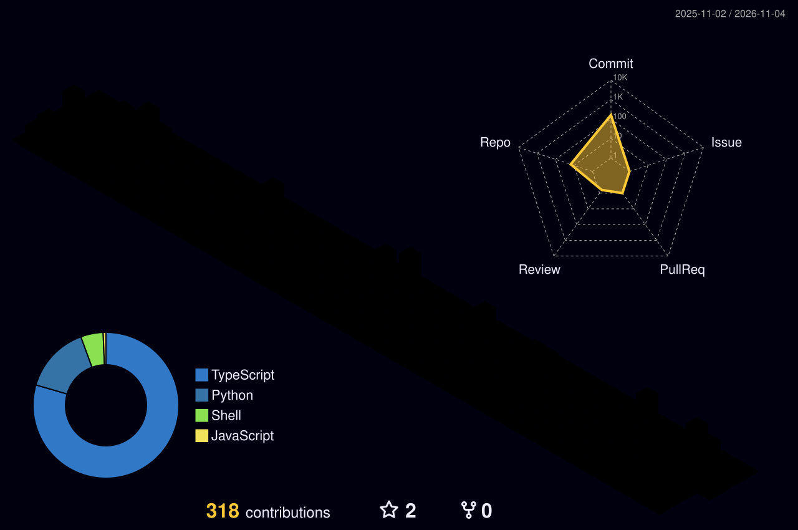
</p>

<!-- Generated every 12h by .github/workflows/snake.yml -->
<p align="center">
  <picture>
    <source media="(prefers-color-scheme: dark)" srcset="https://raw.githubusercontent.com/yashpatil02121/yashpatil02121/output/github-contribution-grid-snake-dark.svg"/>
    <source media="(prefers-color-scheme: light)" srcset="https://raw.githubusercontent.com/yashpatil02121/yashpatil02121/output/github-contribution-grid-snake.svg"/>
    
  </picture>
</p>

<!-- ─────────────── 07 · SETUP ─────────────── -->
<a id="setup"></a>
<p align="center"></p>

```yaml
editor:    VS Code  +  Cursor
ai:        Claude Code                 # pair-programmer & plugin playground
terminal:  PowerShell  ·  Git Bash     # muscle memory: git, pnpm, docker
runtime:   Node.js  ·  Python          # pnpm · venv · uvicorn
ship:      Docker  ·  GitHub Actions  ·  Vercel  ·  Render
data:      PostgreSQL  ·  MongoDB  ·  Elasticsearch
mobile:    Android Studio
```

<!-- ─────────────── 08 · CONNECT ─────────────── -->
<a id="connect"></a>
<p align="center"></p>

<p align="center">
  
</p>

<p align="center">
  <a href="https://www.linkedin.com/in/yash-patil-6655b5215/"></a>
  <a href="https://patilyash.tech">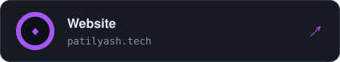</a>
</p>
<p align="center">
  <a href="https://leetcode.com/u/yashpatil2121/"></a>
  <a href="https://www.hackerrank.com/profile/patilyash02121/"></a>
</p>

<h3 align="center">✍️ Guestbook</h3>

<p align="center">
  <a href="https://github.com/yashpatil02121/yashpatil02121/issues/new?template=guestbook.yml">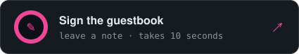</a>
  <a href="https://github.com/yashpatil02121/yashpatil02121/issues?q=label%3Aguestbook"></a>
</p>

<!-- GUESTBOOK:START -->
<p align="center">
<sub>No signatures yet. Be the first! ✍️</sub>
</p>
<!-- GUESTBOOK:END -->

<br/>

<details>
<summary align="center"><sub>⬆️ ⬆️ ⬇️ ⬇️ ⬅️ ➡️ ⬅️ ➡️ 🅱️ 🅰️</sub></summary>
<br/>
<p align="center">
  <b>🥚 You found the easter egg!</b><br/>
  <sub>+30 lives · here's a fresh joke, rerolled every time the page loads:</sub><br/><br/>
  
  <br/><br/>
  <code>while (alive) { eat(); sleep(); code(); repeat(); }</code>
</p>
</details>

<p align="center">
  <a href="#about"></a>
</p>
